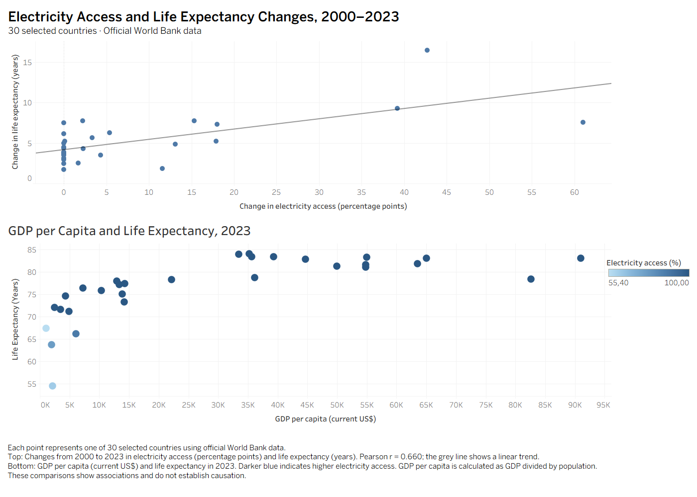

# World Bank SQL Data Pipeline

[](https://github.com/Khaya99/world-bank-sql-data-pipeline/actions/workflows/pipeline-tests.yml)

A Python and PostgreSQL pipeline that downloads World Bank development indicators, validates and upserts country-year observations, and exports analysis-ready CSVs for Tableau. It includes monthly Windows scheduling, timestamped logs, Gmail failure alerts, and automated offline tests through GitHub Actions.

I first built this project in MySQL using deliberately imperfect synthetic data to practise SQL profiling, cleaning and analysis. I later migrated it to PostgreSQL and added a separate pipeline for official World Bank API observations.

## What the project does

- Retrieves six development indicators for **30 selected countries, 2000–2023**: GDP, population, life expectancy, unemployment, CO₂ emissions per capita, and access to electricity.
- Creates a separate UTC-stamped download folder for each run and reports extraction completeness, with bounded retries for temporary request failures.
- Validates official data before publishing it to the PostgreSQL `worldbank` schema; verified refreshes contain **720 country-year rows**.
- Updates existing country-year observations through an upsert, with transactional database validation and refresh logging.
- Exports two CSV reports, checking their headers and 30 unique country codes before replacing each previous report.
- Records stage outcomes and errors locally, and attempts a Gmail notification when a pipeline run fails.
- Runs **10 offline orchestration and alert tests** in GitHub Actions on pushes and pull requests.

## Two datasets, separate purposes

| Dataset | Purpose | Scope and results |
| --- | --- | --- |
| Synthetic learning dataset | Practise profiling, cleaning, quarantine, audit logging and SQL analysis | 729 raw records; 718 cleaned country-year records; 7 quarantined records; 4 excluded duplicates |
| Official World Bank API data | Refresh and analyse official development observations | 30 countries × 24 years = 720 country-year rows in verified refreshes; stored separately in the `worldbank` schema |

Synthetic findings are not official World Bank findings. Official observations can be revised by the source, so future downloads may differ. The monthly run refreshes the fixed **2000–2023** period; it does not automatically extend the analysis to newer years.

## Pipeline flow

1. **Extract:** download a new snapshot using `scripts/fetch_worldbank.py`.
2. **Validate and load:** use `psql` to refresh staging, validate the batch and upsert typed observations in one transaction.
3. **Export:** generate and validate each report CSV, then replace its previous version.
4. **Observe:** write terminal/file logs and record the database refresh in `worldbank.pipeline_runs`; attempt an email if the overall run fails.
5. **Visualise:** refresh the Tableau CSV connections and update saved dashboard outputs separately.

| Output | Contents |
| --- | --- |
| `data/official/<UTC timestamp>/world_bank_indicators.csv` | Downloaded official-data snapshot |
| `data/processed/electricity_life_expectancy_changes_2000_2023.csv` | Electricity-access change in percentage points and life-expectancy change in years, by country |
| `data/processed/development_comparison_2023.csv` | GDP per capita in current US dollars, life expectancy and electricity access for 2023 |
| `logs/pipeline_<run ID>.log` | Pipeline and stage outcomes, duration, subprocess output and error tracebacks |
| `worldbank.pipeline_runs` | Database refresh status, timing, row counts and errors |

## Tools

Python 3.13, pandas, requests, PostgreSQL, SQL, pgAdmin 4, Tableau, Windows Task Scheduler, Git, GitHub and GitHub Actions. MySQL was used for the original version. The current local setup uses PostgreSQL 18 and Windows; Gmail credential decryption is Windows-specific.

## Run the official pipeline

### Prerequisites

- Python 3.13 and PostgreSQL with the `psql` client installed.
- A prepared `world_bank_analytics` database containing `worldbank.indicators_staging`, `worldbank.indicators_typed` and `worldbank.pipeline_runs`.
- Internet access and a running PostgreSQL service.
- Noninteractive PostgreSQL authentication configured for the Windows account running the task.

**The runner refreshes an existing database; it does not bootstrap a new installation.** Review the table definitions in [script 09](sql/09_create_worldbank_staging.sql), [script 10](sql/10_create_worldbank_typed.sql) and [script 15](sql/15_create_pipeline_run_log.sql). Some SQL files include data-loading statements or local paths: review them before executing against a new environment. See the [rebuild checklist](docs/project_rebuild_master_checklist.md) for the project's migration history and setup context.

### Python environment

From the repository root in PowerShell, create the environment if it does not already exist:

```powershell
python -m venv .venv
.\.venv\Scripts\python.exe -m pip install pandas requests
```

Configure the matching PostgreSQL connection in `%APPDATA%\postgresql\pgpass.conf`, outside the repository. The runner uses `psql -w`, so an authentication error fails rather than waiting for a password prompt. Do not commit credentials.

### Run and check the result

```powershell
.\.venv\Scripts\python.exe scripts/run_worldbank_pipeline.py
$LASTEXITCODE
```

Defaults are `localhost:5432`, user `postgres`, database `world_bank_analytics`, and `C:/Program Files/PostgreSQL/18/bin/psql.exe`. Override them when necessary:

```powershell
.\.venv\Scripts\python.exe scripts/run_worldbank_pipeline.py --psql "C:/Program Files/PostgreSQL/18/bin/psql.exe" --host localhost --port 5432 --user postgres --database world_bank_analytics
```

A successful run ends with `Pipeline succeeded` and exit code `0`. A nonzero code indicates failure or interruption. The command updates the local database and report CSVs.

For details, see [run logging and verification](docs/run_logging.md).

## Scheduling and monitoring

| Component | Responsibility |
| --- | --- |
| Windows Task Scheduler | Runs the real API-to-PostgreSQL pipeline monthly on the local computer |
| Python logs | Cover extraction, database refresh, report exports and handled failures |
| PostgreSQL run log | Records the database refresh only |
| Gmail alerts | Attempt to notify the configured Gmail account of a failed or interrupted run |
| GitHub Actions | Runs offline code tests on GitHub; does not refresh the real database |

The configured task, **World Bank Monthly Pipeline**, runs on day 1 of each month at **09:00 South Africa time (UTC+02:00)**. It requires the configured user to be logged on, the computer awake and connected to AC power, and PostgreSQL and Internet access available. Catch-up after a missed start is enabled; automatic whole-task retries are disabled. The task has a 30-minute limit and prevents overlapping scheduled instances.

An automatic catch-up run was verified on **1 November 2026**. An on-demand Task Scheduler run on **10 November 2026** returned `0x0`, refreshed 720 rows and published both reports. A separate deliberate-failure scheduled task also delivered a Gmail alert and was removed after verification.

See [monthly task configuration and verification](docs/monthly_schedule.md). Logs and snapshot folder names use UTC; South African local time is two hours ahead. Scheduling updates local data, not GitHub commits or Tableau publications.

## Gmail failure alerts

The runner attempts one email when its final exit code is nonzero. Successful runs do not send failure alerts. The message contains the exit code, duration and log file path on the laptop; it does not attach the log. If delivery fails, the notification error is logged and the original pipeline exit code is preserved.

The helper sends to the same Gmail address used for authentication. It uses a Google App Password stored in an encrypted Windows credential file outside the repository:

```text
%LOCALAPPDATA%\WorldBankPipeline\gmail-credential.xml
```

To configure credentials on Windows, first create an App Password in your Google account, then run these commands in PowerShell. Enter your Gmail address and App Password in the credential dialog, not in source code:

```powershell
$alertFolder = Join-Path $env:LOCALAPPDATA "WorldBankPipeline"
New-Item -ItemType Directory -Path $alertFolder -Force | Out-Null
$gmailCredential = Get-Credential -Message "Enter your Gmail address and Google App Password"
$gmailCredential | Export-Clixml -Path (Join-Path $alertFolder "gmail-credential.xml")
```

The file is tied to the Windows account and computer that saved it. Task Scheduler must use that account. Never commit or share the credential file or App Password. Missing email credentials do not stop a successful data refresh; they prevent failure notifications from being delivered.

Run the standalone helper to send one real test email:

```powershell
.\.venv\Scripts\python.exe scripts/gmail_alerts.py
```

See [Gmail alert verification](docs/run_logging.md#gmail-failure-alerts).

## Automated tests and continuous integration

Run the same 10 offline tests used by CI from the repository root:

```powershell
python -m unittest discover -s tests -p "test_pipeline_runner.py" -v
```

Use your virtual environment's Python if it is not already activated.

The tests check:

- Extraction failure, missing output and missing `psql` stop downstream work.
- The exact new snapshot and the current Python interpreter are passed to the appropriate stages.
- Database failure codes are preserved without whole-run retry.
- Failed exports preserve the previous report and remove temporary files.
- Successful runs do not attempt a failure email.
- Pipeline failures and unexpected exceptions attempt one failure email.
- Email delivery errors are logged without replacing the pipeline failure code.

These tests mock external pipeline operations and email delivery. They need no API access, PostgreSQL server or Gmail credentials. Expected simulated failures can print tracebacks while the test suite still ends with `OK`.

[GitHub Actions](https://github.com/Khaya99/world-bank-sql-data-pipeline/actions) runs this suite on a Windows runner with Python 3.13 for pushes and pull requests, and supports manual execution. The configuration is [pipeline-tests.yml](.github/workflows/pipeline-tests.yml). All 10 tests passed locally and in GitHub Actions during setup.

This CI job covers `test_pipeline_runner.py`; it does not run every test file in the repository or verify live API, database, SMTP or Task Scheduler behaviour. The repository also includes separate API retry/coverage tests and a PostgreSQL failure/rollback test. See [extraction progress](docs/api_extraction_progress.md) and [database failure testing](docs/run_logging.md#verified-behavior) for their scope.

## Tableau and official-data analysis

The working [CSV-connected workbook](dashboard/official_world_bank_electricity_life_expectancy_2000_2023_live_csv.twb) can reread the updated report through Tableau's data-source Refresh action. On another computer, use Edit Connection to select the local CSV. Packaged workbooks and PNG previews are saved snapshots and need separate updates.

### Official World Bank analysis: electricity access and life expectancy

This analysis uses official World Bank data for 30 selected countries between 2000 and 2023. It extends the project’s earlier synthetic-data analysis with findings from official observations.

Across 720 country-year observations, electricity access and life expectancy had a Pearson correlation of **0.778**. Comparing each country’s change between 2000 and 2023 produced a correlation of **0.660** across 30 countries.

The Tableau dashboard visualizes these changes, with electricity access measured in percentage points and life expectancy measured in years. Each point represents one country.

Countries with larger electricity-access gains tended to have larger life-expectancy gains. This association does not establish causation: the comparison uses two endpoint years and does not account for other influences.

The analysis includes SQL queries, an exported CSV, a Tableau packaged workbook, and a PNG dashboard preview.




## Original synthetic-data project

The original research question was: **How are CO₂ emissions, unemployment and access to electricity related to life expectancy, and how do GDP and population relate to these indicators?**

The workflow covered ingestion, profiling, cleaning, validation, transformation, SQL analysis and Tableau visualisation. Deliberate data-quality issues included missing values, duplicates, incorrect formats and inconsistent country information.

### Cleaning results

The raw table has 729 records. After cleaning, there are 718 unique country-year records. Seven records were quarantined and four duplicates were excluded.

I corrected a population error for Korea, Rep. in 2018 and recorded the change in an audit log. The raw value was kept in the raw table.

Brazil 2022 life expectancy is corrected from 7.5 to 75.0 years, and Mexico 2023 GDP is converted from millions of USD to USD. The raw data remains unchanged. Details and verification are in [Brazil and Mexico corrections](docs/brazil_mexico_corrections.md).

### Synthetic-data findings

The figures below were verified in a separate PostgreSQL rebuild using the corrected scripts. Apply `sql/maintenance/fix_brazil_mexico.sql` in the existing database and rerun validation and analysis to bring that database up to date.

- Electricity access and life expectancy had a positive correlation of 0.780.
- Countries with larger increases in electricity access from 2000 to 2023 generally had larger increases in life expectancy. The correlation was 0.737.
- GDP per capita and life expectancy had a positive correlation of 0.702 across the dataset.
- Population had weak correlations with CO₂ emissions per capita, unemployment and electricity access.

These are relationships in the synthetic data. They do not prove that one indicator caused a change in another. The conflicting Korea, Rep. 2000 duplicate also affects how its change from 2000 to 2023 should be interpreted.

## Repository guide

| Path | Purpose |
| --- | --- |
| `scripts/fetch_worldbank.py` | API extraction, retry handling and completeness reporting |
| `scripts/run_worldbank_pipeline.py` | Pipeline orchestration, report validation, logging and alert integration |
| `scripts/gmail_alerts.py` | Windows credential loading and Gmail delivery |
| `sql/` | Synthetic-data workflow and official-data staging, validation, upsert and analysis SQL |
| `sql/maintenance/` | Corrections and refresh failure handling |
| `tests/` | Offline Python tests and the separate PostgreSQL failure test |
| `.github/workflows/` | GitHub Actions test workflow |
| `data/raw/`, `data/reference/` | Synthetic source data and country reference data |
| `data/official/` | Official snapshots; new timestamped run folders are ignored by Git |
| `data/processed/` | Processed data and report CSVs |
| `logs/` | Local run logs, ignored by Git |
| `dashboard/` | Tableau workbooks and dashboard previews |
| `docs/` | Data dictionary, decisions, corrections, scheduling and verification notes |

## Current limitations

- The fixed country/year scope and SQL validation rules require review before changing the dataset. The current official refresh requires all six indicators to be present; missing source observations can therefore reject a batch.
- Each report is replaced separately after validation. A committed database refresh and an earlier report can remain updated if a later export fails; the entire pipeline is not one transaction.
- Subprocess output is logged when each command completes, not streamed live. Forced termination may leave no final status and a database run marked `running`.
- Alerts depend on network access and valid credentials. They cannot detect a powered-off laptop, a task that never starts, or failures before the runner's error-handling block is active.
- Logs and downloaded snapshots have no automatic retention cleanup. There is no automatic whole-pipeline recovery or missed-run alerting.
- Official API metadata reflects current classifications, not necessarily historical region or income-group classifications. Correlations describe associations and do not establish causation.
- Some setup scripts, database tests and Tableau connections retain local Windows paths. Review these when reproducing the project on another computer.

## Further documentation

- [Data dictionary](docs/data_dictionary.md)
- [Project evolution and decisions](docs/project_evolution_and_decision_log.md)
- [Rebuild checklist](docs/project_rebuild_master_checklist.md)
- [API extraction history](docs/api_extraction_progress.md)
- [Run logging, report exports and Gmail alerts](docs/run_logging.md)
- [Monthly scheduling](docs/monthly_schedule.md)
- [Brazil and Mexico corrections](docs/brazil_mexico_corrections.md)

Some linked notes describe earlier milestones. The current runner and CI workflow define the implemented behaviour described above.
